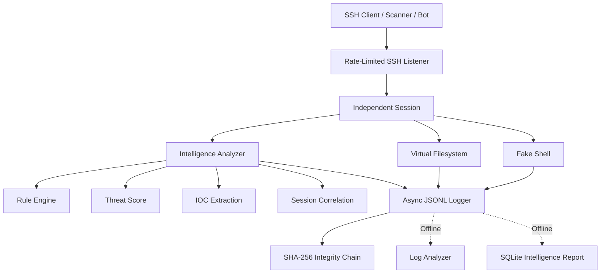

# 🐝 Fake Ubuntu SSH Honeypot

**Interactive Ubuntu 22.04 SSH Honeypot with Threat Intelligence, IOC Extraction, Risk Scoring and Hardened Docker Deployment**

**Version:** `3.0.1`  
**Python:** `>= 3.10`  
**SSH Engine:** `Paramiko 5.0.0`  
**Deployment:** Docker / Docker Compose  
**Logging:** Structured JSONL + SHA-256 Hash Chain  
**Status:** Production-oriented / Security-hardened

---

## 🇬🇧 English

### Overview

**Fake Ubuntu SSH Honeypot** is an interactive SSH deception system designed to simulate an Ubuntu Server 22.04 environment while keeping attacker-controlled input isolated from the real operating system.

The honeypot provides:

- Fake Ubuntu shell
- Per-session virtual filesystem
- SSH authentication capture
- Structured JSONL logging
- Command intelligence analysis
- Threat scoring
- IOC extraction
- Session behavior correlation
- Download → execution chain detection
- Security alerts
- Log integrity hash chaining
- Offline log analysis
- Hardened Docker deployment

> **Important security invariant:** attacker-controlled commands are never intentionally passed to a real host shell, process launcher, filesystem API, DNS resolver, downloader or outbound network client.

Commands such as `wget`, `curl`, `ping`, `apt`, `python3`, `git` and `docker` are **simulated** by the honeypot.

---

# ✨ Main Features

### 🐧 Realistic Ubuntu SSH Environment

The honeypot emulates an Ubuntu Server environment including:

- Ubuntu-style SSH banner
- Fake hostname
- Fake users
- Fake `/etc/passwd`
- Fake process information
- Fake networking output
- Fake filesystem
- Shell history
- Ubuntu-like command responses
- Persistent SSH host key in production

Example:

```text
Welcome to Ubuntu 22.04.5 LTS (GNU/Linux 5.15.0-122-generic x86_64)

root@server01:~# whoami
root

root@server01:~# uname -a
Linux server01 5.15.0-122-generic ...
```

---

## 🧠 Threat Intelligence Engine

Every accepted command can be analyzed by the built-in intelligence engine.

Example:

```bash
wget http://example.com/test.sh
```

may produce intelligence similar to:

```json
{
  "category": "delivery",
  "risk_score": 35,
  "risk_level": "medium",
  "matched_rules": [
    "payload_download"
  ]
}
```

The engine supports:

- Rule-based detection
- Parsed command matching
- Regex detection
- Confidence scoring
- Threat scoring
- Behavior categorization
- Session-aware correlation
- IOC extraction
- Alert deduplication
- Bounded analysis cache

---

## 🔥 Attack Chain Correlation

The analyzer does not only inspect commands independently.

It keeps bounded per-session intelligence state and can correlate behavior.

Example:

```text
wget payload.sh
        ↓
./payload.sh
```

can trigger:

```text
payload_download
local_payload_execution
download_then_execute
```

A correlated execution attempt may receive a critical risk score.

This correlation represents **observed attacker intent**, not proof that a real file was downloaded or executed.

---

## 🎯 Sensitive File Discovery

Access to sensitive account information is detected.

Example:

```bash
cat /etc/passwd
```

triggers:

```text
Rule: passwd_file_access
Category: discovery
Score: 20
```

Similar supported read operations can also be detected when targeting `/etc/passwd`.

---

## 🔎 IOC Extraction

The intelligence engine can extract bounded indicators such as:

- IPv4 addresses
- Domains
- URLs
- File names
- Artifacts
- MD5 hashes
- SHA-256 hashes

Example:

```bash
wget http://example.com/test.sh
```

may generate:

```json
{
  "hosts": ["example.com"],
  "files": ["test.sh"],
  "urls": ["http://example.com/test.sh"]
}
```

IOC extraction is intentionally bounded to protect memory and avoid uncontrolled high-cardinality state.

---

## 📊 Threat Scoring

Detections contribute to a command and session threat score.

Threat levels:

| Score | Level |
|---:|---|
| `< 10` | NONE |
| `10–29` | LOW |
| `30–59` | MEDIUM |
| `60–89` | HIGH |
| `90+` | CRITICAL |

The maximum score can be configured through:

```text
HONEYPOT_MAX_SCORE
```

Default:

```text
1000
```

---

## 🚨 Intelligence Alerts

When a command reaches the configured alert threshold, an `intelligence_alert` event is emitted.

Default threshold:

```text
65
```

Configure with:

```dotenv
HONEYPOT_ALERT_MIN_RISK=65
```

Alerts are deduplicated per primary rule within the same session.

The alert event does not repeat the complete command text.

---

# 🏗 Architecture



Each SSH connection receives its own session state.

Virtual filesystem content and session intelligence are destroyed when the session ends.

---

# 📁 Project Structure

```text
SSH-Honeypot/
│
├── honeypot/
│   ├── __main__.py
│   ├── main.py
│   ├── config.py
│   ├── ssh_server.py
│   ├── shell.py
│   ├── session.py
│   ├── commands.py
│   ├── filesystem.py
│   ├── fake_data.py
│   ├── logger.py
│   ├── rate_limit.py
│   ├── keygen.py
│   ├── healthcheck.py
│   │
│   ├── intelligence/
│   │   ├── analyzer.py
│   │   ├── rules.py
│   │   ├── patterns.py
│   │   ├── indicators.py
│   │   ├── threat_score.py
│   │   └── cache.py
│   │
│   └── security/
│       └── integrity.py
│
├── tools/
│   ├── analyze_log.py
│   └── intel_report.py
│
├── tests/
│
├── Dockerfile
├── compose.yaml
├── pyproject.toml
├── requirements.txt
├── requirements.lock
├── requirements-dev.txt
├── .env.example
├── SECURITY.md
├── OPERATIONS.md
├── CHANGELOG.md
└── RELEASE.md
```

---

# 🚀 Quick Start — Docker

Docker Compose is the recommended production deployment method.

## 1. Clone the repository

```bash
git clone https://github.com/zero19bit/SSH-Honeypot.git
cd SSH-Honeypot
```

---

## 2. Build the image

```bash
docker compose build --pull
```

Expected image:

```text
fake-ubuntu-ssh-honeypot:3.0.1
```

---

## 3. Generate a stable SSH Host Key

Production mode requires a persistent SSH host key.

Generate one with:

```bash
docker run --rm --entrypoint python \
  fake-ubuntu-ssh-honeypot:3.0.1 \
  -m honeypot.keygen > host-key.b64
```

The generated file contains a single Base64 line.

**Never commit this key to Git.**

---

## 4. Create the environment file

```bash
cp .env.example .env
chmod 600 .env
```

Edit:

```bash
nano .env
```

Set:

```dotenv
HONEYPOT_HOST_KEY_B64=YOUR_ONE_LINE_BASE64_HOST_KEY
```

Keep the production credential mode as:

```dotenv
HONEYPOT_CREDENTIAL_LOG_MODE=sha256
```

Do not place the Base64 host key in `HONEYPOT_CREDENTIAL_LOG_MODE`.

---

## 5. Start the Honeypot

```bash
docker compose up -d
```

Check status:

```bash
docker compose ps
```

A healthy deployment should eventually show:

```text
Up ... (healthy)
```

View logs:

```bash
docker compose logs --tail=50 honeypot
```

A successful startup generates a `listener_started` event.

---

## 6. Connect locally

```bash
ssh -p 2222 \
  -o PreferredAuthentications=password \
  -o PubkeyAuthentication=no \
  root@127.0.0.1
```

The honeypot intentionally accepts password authentication attempts.

Production logging does **not** store the raw password by default.

---

# 🧪 Example Interaction

```bash
whoami
uname -a
cat /etc/passwd
wget http://example.com/test.sh
./test.sh
exit
```

These commands are processed inside the simulated environment.

An unsupported fake command may return exit status `127`. This does **not** cause it to execute on the host.

---

# 💻 Development Mode

For local development without Docker:

```bash
python3 -m venv .venv
source .venv/bin/activate
```

Install locked runtime dependencies:

```bash
python -m pip install --require-hashes -r requirements.lock
```

Run:

```bash
python -m honeypot \
  --development \
  --host 127.0.0.1 \
  --port 2222
```

Development mode generates a temporary RSA host key.

Production mode requires:

```text
HONEYPOT_HOST_KEY_B64
```

If port `2222` is already used:

```bash
python -m honeypot \
  --development \
  --host 127.0.0.1 \
  --port 2223
```

Then connect using:

```bash
ssh -p 2223 root@127.0.0.1
```

---

# 🧰 Simulated Commands

The honeypot includes fake implementations for common Linux commands.

| Category | Commands |
|---|---|
| System | `whoami`, `id`, `hostname`, `uname`, `uptime`, `date`, `history` |
| Filesystem | `ls`, `ll`, `cd`, `pwd`, `cat`, `head`, `tail`, `find`, `touch`, `mkdir`, `rm`, `nano`, `vim` |
| Networking | `ip`, `ifconfig`, `netstat`, `ss`, `ping` |
| Resources | `ps`, `top`, `free`, `df`, `du` |
| Management | `systemctl`, `service`, `apt`, `apt-get` |
| Tools | `wget`, `curl`, `python3`, `git`, `docker`, `docker compose` |

The internal parser also supports bounded command chains including:

```text
;
&&
||
|
```

and pipelines involving utilities such as:

```text
grep
head
tail
```

No real shell is used to execute these chains.

---

# 🧱 Virtual Filesystem

Every session receives an independent in-memory virtual filesystem.

Default limits include:

```text
Maximum VFS nodes:       2048
Maximum total VFS size:  2 MiB
Maximum file size:       128 KiB
Maximum path length:     512
Maximum name length:     255
```

The virtual filesystem never writes attacker-controlled files to the host filesystem.

Session VFS data is destroyed when the session terminates.

---

# 🔐 Credential Logging

Three credential logging modes exist:

### `sha256`

Default production mode.

Stores:

```json
{
  "password_sha256": "...",
  "password_length": 12
}
```

It does not store the plaintext password.

---

### `redact`

Stores only metadata such as password length.

Recommended when password digests are unnecessary.

---

### `plain`

Stores attempted passwords in plaintext.

⚠️ **Development only.**

Production mode rejects:

```dotenv
HONEYPOT_CREDENTIAL_LOG_MODE=plain
```

Raw commands can still contain credentials or tokens, so logs must always be treated as sensitive data.

---

# 📝 Structured Logging

Runtime events are written as JSON Lines.

Important events include:

```text
listener_started
connection_open
ssh_negotiated
authentication
shell_open
command
intelligence_alert
connection_rejected
runtime_metrics
disconnect
startup_failed
analyzer_error
```

Example command event:

```json
{
  "event": "command",
  "session_id": "...",
  "attacker_ip": "...",
  "command": "uname -a",
  "threat": {
    "score": 15,
    "severity": "LOW"
  },
  "analysis": {
    "category": "reconnaissance",
    "matched_rules": [
      "system_discovery"
    ]
  }
}
```

---

# 🔗 Log Integrity

Version `3.0.1` supports SHA-256 hash chaining.

Each log entry contains:

```json
{
  "integrity": {
    "algorithm": "sha256",
    "prev_hash": "...",
    "hash": "..."
  }
}
```

This allows modifications or missing records inside a collected process log to be detected.

It is **not a cryptographic signature**.

An attacker who can completely rewrite the log and recompute every hash could construct a new chain.

For production environments, retain immutable or remote log copies.

---

# 📥 Export JSONL Logs

Export Docker logs:

```bash
docker compose logs \
  --no-color \
  --no-log-prefix \
  honeypot > honeypot.jsonl
```

---

# 🔍 Offline Log Analysis

Analyze a collected JSONL file:

```bash
python3 tools/analyze_log.py honeypot.jsonl
```

JSON output:

```bash
python3 tools/analyze_log.py honeypot.jsonl --json
```

The tool can validate the integrity chain for a single process run.

Old logs without integrity hashes are reported as:

```text
UNVERIFIED
```

---

# 🗄 Offline SQLite Intelligence Database

Import logs into SQLite:

```bash
python3 tools/intel_report.py \
  ingest honeypot.jsonl \
  --db intel.sqlite
```

Generate a report:

```bash
python3 tools/intel_report.py \
  report \
  --db intel.sqlite
```

JSON report:

```bash
python3 tools/intel_report.py \
  report \
  --db intel.sqlite \
  --json
```

By default, the intelligence database does **not** store plaintext passwords.

Raw command storage is also disabled unless explicitly requested.

To include raw commands:

```bash
python3 tools/intel_report.py \
  ingest honeypot.jsonl \
  --db intel.sqlite \
  --include-commands
```

If `--include-commands` is used, protect the SQLite file as sensitive evidence.

---

# ⚙️ Important Configuration

Configuration is provided through environment variables.

| Variable | Default | Description |
|---|---:|---|
| `HONEYPOT_HOST_KEY_B64` | Required in Production | Base64 encoded RSA host private key |
| `HONEYPOT_PUBLIC_BIND` | `127.0.0.1` | Published host address |
| `HONEYPOT_PUBLIC_PORT` | `2222` | Published SSH port |
| `HONEYPOT_HOSTNAME` | `server01` | Fake server hostname |
| `HONEYPOT_CREDENTIAL_LOG_MODE` | `sha256` | Credential capture mode |
| `HONEYPOT_ALERT_MIN_RISK` | `65` | Intelligence alert threshold |
| `HONEYPOT_INTELLIGENCE_ENABLED` | `true` | Enable command intelligence |
| `HONEYPOT_IOC_ENABLED` | `true` | Enable IOC extraction |
| `HONEYPOT_LOG_HASHING` | `true` | Enable JSONL hash chaining |
| `HONEYPOT_MAX_SESSION_HISTORY` | `500` | Intelligence history size |
| `HONEYPOT_MAX_SCORE` | `1000` | Maximum accumulated score |
| `HONEYPOT_MAX_CONNECTIONS` | `64` | Global active connection limit |
| `HONEYPOT_MAX_CONNECTIONS_PER_IP` | `4` | Per-source connection limit |
| `HONEYPOT_IP_RATE_PER_MINUTE` | `12` | Per-IP admission rate |
| `HONEYPOT_MAX_SESSION_SECONDS` | `900` | Maximum session lifetime |
| `HONEYPOT_VFS_MAX_NODES` | `2048` | Virtual filesystem node limit |
| `HONEYPOT_VFS_MAX_TOTAL_BYTES` | `2097152` | Virtual filesystem size limit |

See `.env.example` and `honeypot/config.py` for the full configuration set.

---

# 🛡 Docker Hardening

The provided Compose configuration includes:

- Numeric non-root user
- Read-only root filesystem
- All Linux capabilities dropped
- `no-new-privileges`
- `/tmp` mounted with `noexec`, `nosuid` and `nodev`
- CPU limit
- RAM limit
- PID limit
- File descriptor limits
- Log rotation
- Restart policy
- Healthcheck
- Graceful `SIGTERM` shutdown

The honeypot application itself does not intentionally create outbound connections from attacker commands.

However:

> The supplied Docker bridge is currently **not an egress firewall**.

Before exposing the service to the Internet, block container outbound traffic using the host firewall or cloud network policy.

---

# 🌐 Public Deployment

By default the service binds to:

```text
127.0.0.1
```

For public exposure, first establish outbound firewall restrictions.

Then change:

```dotenv
HONEYPOT_PUBLIC_BIND=0.0.0.0
```

Restart:

```bash
docker compose up -d
```

### Using public port 22

Do **not** move the honeypot to port `22` until your real administrative SSH access has been moved elsewhere.

After securing management access:

```dotenv
HONEYPOT_PUBLIC_PORT=22
```

The application still runs internally as an unprivileged user on port `2222`; Docker performs host port publishing.

---

# 🧪 Testing

Create a development environment:

```bash
python3 -m venv .venv
source .venv/bin/activate
```

Install development dependencies:

```bash
pip install -r requirements-dev.txt
```

Run the complete test suite:

```bash
pytest -q
```

or:

```bash
make test
```

Build Docker:

```bash
make docker
```

---

# 🔍 Dependency Audit

Run:

```bash
pip-audit -r requirements.lock
```

Runtime dependencies are exact-pinned with hashes in:

```text
requirements.lock
```

CI should run:

1. Tests
2. Dependency audit
3. Fresh container build

before release.

---

# ❤️ Healthcheck

The Docker container includes an internal healthcheck.

Check:

```bash
docker compose ps
```

Expected:

```text
healthy
```

The healthcheck performs a local TCP connection to the SSH listener.

Because of this, occasional short-lived SSH transport errors from local container health probes may appear in logs.

---

# 🧯 Troubleshooting

## Container keeps restarting

Check:

```bash
docker compose logs --tail=100 honeypot
```

---

### `HONEYPOT_HOST_KEY_B64 is required in production mode`

Your production Host Key is missing.

Generate:

```bash
docker run --rm --entrypoint python \
  fake-ubuntu-ssh-honeypot:3.0.1 \
  -m honeypot.keygen > host-key.b64
```

Put the generated Base64 line in:

```dotenv
HONEYPOT_HOST_KEY_B64=...
```

---

### `credential_log_mode must be plain, sha256, or redact`

Check `.env`.

Correct:

```dotenv
HONEYPOT_CREDENTIAL_LOG_MODE=sha256
```

Incorrect:

```dotenv
HONEYPOT_CREDENTIAL_LOG_MODE=<BASE64 PRIVATE KEY>
```

The Base64 private key belongs in:

```dotenv
HONEYPOT_HOST_KEY_B64=
```

---

## Port 2222 is already allocated

Check:

```bash
docker ps
```

Stop the old honeypot:

```bash
docker stop <container-name>
```

or change:

```dotenv
HONEYPOT_PUBLIC_PORT=2223
```

Then:

```bash
docker compose up -d
```

Connect:

```bash
ssh -p 2223 root@127.0.0.1
```

---

## `REMOTE HOST IDENTIFICATION HAS CHANGED`

This commonly happens after changing the honeypot Host Key.

Remove the old local fingerprint:

```bash
ssh-keygen \
  -f ~/.ssh/known_hosts \
  -R '[127.0.0.1]:2222'
```

Reconnect and verify the new fingerprint.

---

## Existing Docker network warning

You may see:

```text
a network with name fake-ssh-honeynet exists
but was not created for this project
```

This usually means an older honeypot Compose project created the same named network.

Inspect it before changing anything:

```bash
docker network inspect fake-ssh-honeynet
```

If it belongs only to an old deployment and is no longer required:

```bash
docker network rm fake-ssh-honeynet
```

Do not remove a network currently used by other containers.

---

## Docker Hub returns `403 Forbidden`

Authenticate:

```bash
docker login
```

Test the base image:

```bash
docker pull python:3.12-slim-bookworm
```

Then rebuild:

```bash
docker compose build
```

---

# 🔒 Security Model

The core security invariant is:

> **Attacker-controlled input must never reach a real shell, process launcher, host filesystem or outbound network client.**

The actual attack surface is intentionally limited primarily to:

- Inbound TCP listener
- Paramiko
- Python runtime
- Configuration parser
- Structured logging

If any attacker-controlled input is found to:

- launch a real process;
- modify a real host file;
- read a real host file;
- initiate an outbound connection;

treat it as a **critical security vulnerability** and remove the deployment from the network until fixed.

---

# ⚠️ Deployment Recommendations

For Internet-facing deployments:

- Use a dedicated VPS or VM.
- Do not run beside production workloads.
- Do not run the process as root.
- Do not expose your real management SSH on the same public endpoint.
- Restrict management through VPN, private interface or allowlisted access.
- Block outbound container traffic at host/cloud level.
- Protect and rotate logs.
- Keep the Host Key private.
- Keep `.env` outside version control.
- Keep immutable or remote log backups.
- Run tests and dependency audits before upgrades.

---

# 🚫 Files That Must Never Be Committed

Keep the following out of Git:

```text
.env
.venv/
host-key.b64
honeypot_host_key
honeypot_host_key.pub
*.log
*.jsonl
__pycache__/
.pytest_cache/
```

Never commit a production SSH private key.

---

# 🔄 Safe Upgrade Procedure

Before upgrading:

```bash
pytest -q
pip-audit -r requirements.lock
docker compose build --pull --no-cache
```

Export important logs.

Preserve the existing Host Key if you want clients to see the same SSH fingerprint after upgrading.

Deploy:

```bash
docker compose up -d
```

Verify:

```bash
docker compose ps
docker compose logs --tail=50 honeypot
```

Look for:

```text
listener_started
```

and confirm the expected host-key fingerprint.

---

# 🛑 Shutdown

Graceful shutdown:

```bash
docker compose down --timeout 15
```

The service handles `SIGTERM`, closes listeners and active sockets, allows worker threads to exit and flushes queued logs.

The virtual filesystem exists only in memory and disappears when sessions or containers terminate.

---

# ⚖️ Responsible Use

This project is intended for:

- Defensive security research
- Honeypot experimentation
- Threat intelligence collection
- Cybersecurity education
- Controlled laboratory environments
- Authorized monitoring

Deploy only on infrastructure you own or are authorized to monitor.

Depending on jurisdiction, collection of credentials, IP addresses, command history or other attacker data may have legal and privacy implications.

You are responsible for complying with applicable laws and policies.

---

# 📚 Additional Documentation

More detailed documentation is available in:

```text
SECURITY.md
OPERATIONS.md
CHANGELOG.md
RELEASE.md
```

---

# 🧩 Version

Current release:

```text
v3.0.1
```

Runtime:

```bash
python -m honeypot --version
```

---

# 🇮🇷 فارسی

## معرفی پروژه

**Fake Ubuntu SSH Honeypot** یک هانی‌پات تعاملی SSH است که محیطی مشابه **Ubuntu Server 22.04** در اختیار مهاجم، اسکنر یا Bot قرار می‌دهد؛ بدون اینکه دستورات ورودی به Shell واقعی سیستم، Processهای واقعی، فایل‌سیستم میزبان یا Downloader واقعی منتقل شوند.

هدف پروژه این است که بتوان رفتار مهاجم را در یک محیط کنترل‌شده مشاهده، ثبت و تحلیل کرد.

نسخه `3.0.1` علاوه بر شبیه‌سازی SSH، دارای یک **Threat Intelligence Engine داخلی** است که می‌تواند دستورات را تحلیل کند، رفتارها را دسته‌بندی کند، IOC استخراج کند و برای فعالیت‌های پرریسک هشدار تولید کند.

---

# ⭐ قابلیت‌ها

نسخه فعلی شامل موارد زیر است:

- شبیه‌سازی Ubuntu Server 22.04
- SSH Server مبتنی بر Paramiko
- Fake Shell تعاملی
- Virtual Filesystem مستقل برای هر Session
- ثبت Authentication Attempt
- JSONL Logging
- Threat Intelligence Engine
- Rule Engine
- Regex Detection
- Threat Scoring
- Confidence Scoring
- IOC Extraction
- Session Behavior Tracking
- Attack Chain Correlation
- Intelligence Alert
- SHA-256 Log Integrity Chain
- Rate Limiting
- Connection Limiting
- Session Timeout
- VFS Quota
- Docker Hardening
- Offline Log Analyzer
- SQLite Intelligence Report
- Healthcheck
- CI و Dependency Audit

---

# 🧠 موتور هوشمندی

هر فرمانی که داخل Session اجرا شود می‌تواند توسط Analyzer بررسی شود.

برای مثال:

```bash
whoami
```

ممکن است به شکل زیر تشخیص داده شود:

```text
system_discovery
reconnaissance
LOW
```

یا:

```bash
wget http://example.com/test.sh
```

به عنوان:

```text
payload_download
delivery
MEDIUM
```

تحلیل شود.

---

# 🔥 تشخیص زنجیره حمله

Analyzer فقط یک Command را جداگانه بررسی نمی‌کند.

اطلاعات محدود Session را نگه می‌دارد.

مثلاً:

```text
wget test.sh
      ↓
./test.sh
```

می‌تواند باعث تشخیص:

```text
download_then_execute
```

شود.

این تشخیص به معنی اجرای واقعی Malware نیست؛ فقط نشان‌دهنده **رفتار مشاهده‌شده و Intent احتمالی مهاجم** است.

---

# 🎯 تشخیص دسترسی به `/etc/passwd`

دستور:

```bash
cat /etc/passwd
```

Rule زیر را فعال می‌کند:

```text
passwd_file_access
```

با مشخصات:

```text
Category: discovery
Score: 20
Threat: LOW
```

---

# 🔎 استخراج IOC

سیستم می‌تواند Indicatorهای زیر را از فرمان‌ها استخراج کند:

- IP
- Domain
- URL
- File
- Artifact
- MD5
- SHA-256

مثلاً:

```bash
wget http://example.com/test.sh
```

می‌تواند موارد زیر را ثبت کند:

```text
example.com
http://example.com/test.sh
test.sh
```

---

# 📊 امتیازدهی Threat

سطوح Threat:

| امتیاز | سطح |
|---:|---|
| کمتر از 10 | NONE |
| 10 تا 29 | LOW |
| 30 تا 59 | MEDIUM |
| 60 تا 89 | HIGH |
| 90 به بالا | CRITICAL |

---

# 🚀 نصب سریع با Docker

## ۱. Clone

```bash
git clone https://github.com/zero19bit/SSH-Honeypot.git
cd SSH-Honeypot
```

---

## ۲. Build

```bash
docker compose build --pull
```

---

## ۳. ساخت Host Key

```bash
docker run --rm --entrypoint python \
  fake-ubuntu-ssh-honeypot:3.0.1 \
  -m honeypot.keygen > host-key.b64
```

---

## ۴. ساخت `.env`

```bash
cp .env.example .env
chmod 600 .env
```

فایل را باز کنید:

```bash
nano .env
```

مقدار `host-key.b64` را مقابل:

```dotenv
HONEYPOT_HOST_KEY_B64=
```

قرار دهید.

Credential mode در Production بهتر است:

```dotenv
HONEYPOT_CREDENTIAL_LOG_MODE=sha256
```

باشد.

---

## ۵. اجرا

```bash
docker compose up -d
```

وضعیت:

```bash
docker compose ps
```

باید در نهایت:

```text
healthy
```

نمایش داده شود.

---

## ۶. مشاهده Log

```bash
docker compose logs --tail=50 honeypot
```

---

## ۷. اتصال SSH

```bash
ssh -p 2222 \
  -o PreferredAuthentications=password \
  -o PubkeyAuthentication=no \
  root@127.0.0.1
```

---

# 🧪 تست پیشنهادی

بعد از ورود:

```bash
whoami
uname -a
cat /etc/passwd
wget http://example.com/test.sh
./test.sh
exit
```

سپس:

```bash
docker compose logs --tail=100 honeypot
```

در Log باید اطلاعاتی مانند:

```text
system_discovery
passwd_file_access
payload_download
download_then_execute
```

را بسته به Commandهای اجراشده مشاهده کنید.

---

# 💻 اجرای مستقیم Development

```bash
python3 -m venv .venv
source .venv/bin/activate
```

نصب:

```bash
python -m pip install --require-hashes -r requirements.lock
```

اجرا:

```bash
python -m honeypot \
  --development \
  --host 127.0.0.1 \
  --port 2222
```

اگر 2222 اشغال بود:

```bash
python -m honeypot \
  --development \
  --host 127.0.0.1 \
  --port 2223
```

---

# 🔐 نحوه ذخیره Password

حالت Production به‌صورت پیش‌فرض:

```dotenv
HONEYPOT_CREDENTIAL_LOG_MODE=sha256
```

است.

در نتیجه Password خام ذخیره نمی‌شود.

مثال:

```json
{
  "password_sha256": "...",
  "password_length": 4
}
```

حالت‌های موجود:

```text
sha256
redact
plain
```

اما `plain` در Production مجاز نیست و فقط برای Development در نظر گرفته شده است.

---

# 📝 دریافت Log به صورت JSONL

```bash
docker compose logs \
  --no-color \
  --no-log-prefix \
  honeypot > honeypot.jsonl
```

---

# 🔍 تحلیل Log

```bash
python3 tools/analyze_log.py honeypot.jsonl
```

یا:

```bash
python3 tools/analyze_log.py honeypot.jsonl --json
```

---

# 🗄 ساخت دیتابیس SQLite آفلاین

```bash
python3 tools/intel_report.py \
  ingest honeypot.jsonl \
  --db intel.sqlite
```

گزارش:

```bash
python3 tools/intel_report.py \
  report \
  --db intel.sqlite
```

JSON:

```bash
python3 tools/intel_report.py \
  report \
  --db intel.sqlite \
  --json
```

---

# 🧪 اجرای تست‌ها

```bash
python3 -m venv .venv
source .venv/bin/activate
pip install -r requirements-dev.txt
pytest -q
```

یا:

```bash
make test
```

---

# 🔐 Dependency Audit

```bash
pip-audit -r requirements.lock
```

---

# 🐳 Docker Build Test

```bash
make docker
```

یا:

```bash
docker compose build
```

---

# 🧯 رفع خطاهای متداول

### کانتینر روی Restarting مانده

```bash
docker compose logs --tail=100 honeypot
```

را بررسی کنید.

---

### خطای Host Key

اگر:

```text
HONEYPOT_HOST_KEY_B64 is required in production mode
```

دیدید، Host Key تولید و داخل `.env` قرار نگرفته است.

---

### خطای Credential Mode

اگر:

```text
credential_log_mode must be plain, sha256, or redact
```

مشاهده شد، مقدار زیر را بررسی کنید:

```dotenv
HONEYPOT_CREDENTIAL_LOG_MODE=sha256
```

---

### خطای اشغال بودن پورت

اگر:

```text
Bind for 127.0.0.1:2222 failed:
port is already allocated
```

ابتدا:

```bash
docker ps
```

را اجرا کنید.

سپس Container قدیمی را Stop کنید یا:

```dotenv
HONEYPOT_PUBLIC_PORT=2223
```

قرار دهید.

---

### خطای تغییر SSH Host Key

اگر:

```text
REMOTE HOST IDENTIFICATION HAS CHANGED
```

مشاهده شد:

```bash
ssh-keygen \
  -f ~/.ssh/known_hosts \
  -R '[127.0.0.1]:2222'
```

سپس دوباره اتصال را برقرار کنید.

---

### خطای Docker Hub 403

```bash
docker login
```

بعد:

```bash
docker pull python:3.12-slim-bookworm
```

و دوباره:

```bash
docker compose build
```

---

# 🛡 نکات امنیتی مهم

این پروژه را روی سیستمی که اطلاعات یا سرویس مهم دارد اجرا نکنید.

برای Deployment اینترنتی:

1. از VPS یا VM جدا استفاده کنید.
2. Honeypot را کنار Production Workload قرار ندهید.
3. SSH مدیریتی واقعی را از endpoint هانی‌پات جدا کنید.
4. Egress کانتینر را در Firewall سیستم یا Cloud Policy ببندید.
5. `.env` را Commit نکنید.
6. Host Private Key را Commit نکنید.
7. دسترسی به Logها را محدود کنید.
8. Log Retention تعریف کنید.
9. قبل از Upgrade تست و Audit انجام دهید.
10. سرویس را با Root اجرا نکنید.

---

# 🚫 فایل‌هایی که نباید روی GitHub بروند

```text
.env
.venv/
host-key.b64
honeypot_host_key
honeypot_host_key.pub
*.log
*.jsonl
__pycache__/
.pytest_cache/
```

---

# ⚠️ نکته درباره Egress

Docker Compose فعلی:

```text
internal: false
```

دارد.

بنابراین Docker network به تنهایی مانع دسترسی خروجی نیست.

قبل از انتشار Honeypot روی اینترنت، Egress کانتینر را با:

- Host Firewall
- Cloud Firewall
- Network Policy

محدود کنید.

---

# 🌍 انتشار عمومی

به‌صورت پیش‌فرض:

```dotenv
HONEYPOT_PUBLIC_BIND=127.0.0.1
```

است.

بعد از اعمال محدودیت‌های شبکه، برای انتشار عمومی:

```dotenv
HONEYPOT_PUBLIC_BIND=0.0.0.0
```

قرار دهید.

---

# ⚠️ استفاده از پورت 22

قبل از اینکه Honeypot را روی پورت `22` منتشر کنید، SSH مدیریتی واقعی خود را به مسیر دیگری منتقل کنید.

بعد:

```dotenv
HONEYPOT_PUBLIC_PORT=22
```

قرار دهید.

---

# 🛑 توقف

```bash
docker compose down --timeout 15
```

با توقف سرویس:

- Listener بسته می‌شود
- Connectionها قطع می‌شوند
- Workerها فرصت خروج دارند
- صف Log flush می‌شود
- VFSهای داخل RAM از بین می‌روند

---

# ⚖️ استفاده مسئولانه

این پروژه برای موارد زیر طراحی شده است:

- Defensive Security
- Cybersecurity Research
- Threat Intelligence
- Honeypot Research
- آموزش امنیت
- آزمایشگاه‌های کنترل‌شده
- مانیتورینگ مجاز

فقط روی زیرساختی استفاده کنید که مالک آن هستید یا مجوز مانیتورینگ آن را دارید.

جمع‌آوری IP، Password Attempt، Command History و سایر اطلاعات ممکن است مشمول قوانین حریم خصوصی یا الزامات قانونی محل استقرار سرور باشد.

مسئولیت رعایت قوانین بر عهده اپراتور Honeypot است.

---

# 📚 مستندات بیشتر

فایل‌های زیر اطلاعات تکمیلی پروژه را دارند:

```text
SECURITY.md
OPERATIONS.md
CHANGELOG.md
RELEASE.md
```

---

# 🏷 Current Release

```text
Fake Ubuntu SSH Honeypot
Version 3.0.1
```

بررسی نسخه:

```bash
python -m honeypot --version
```

---

## ⭐ Support the Project

If you find this project useful:

- ⭐ Star the repository
- 🐛 Report reproducible bugs
- 🔐 Report security issues responsibly
- 🧪 Add tests for new behavior
- 📖 Improve documentation
- 🛡 Preserve the project's isolation and no-real-execution security invariants

**Built for defensive security research and threat observation.**
